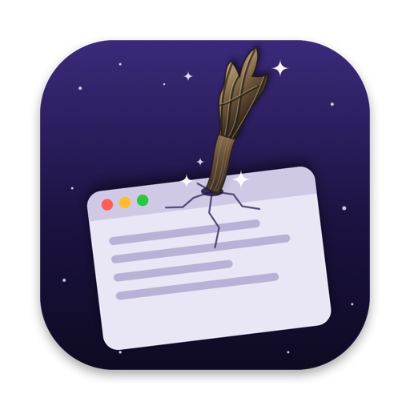

<p align="center">
  
</p>

# YouShallNotMove

A macOS menu bar app that keeps your windows where you put them.

A click on a title bar with a shaky hand moves the window by one or two pixels.
YouShallNotMove blocks window drags unless you hold a modifier key (⌘ by default).

## How it works

- An event tap watches left mouse clicks and drags.
- Click on a native title bar or an empty toolbar area: the mouse-down is held back.
  - Released within 4 px: the click is replayed, so the window still activates.
  - Dragged further: the drag is cancelled.
- Elsewhere (window background drags, custom title bars like Chrome's tab strip):
  - As soon as the window moves, a mouse-up ends the window server drag.
  - The window goes back to its original frame.
  - A one-pixel glitch can remain.
- Hold the modifier key when you click to move the window normally.
- Resizing from an edge, double-clicking a title bar and the green button are not blocked.

## Build and install

Requires the Xcode command line tools.

```bash
./build.sh
```

The script builds `YouShallNotMove.app`, signs it, installs it in `~/Applications` and launches it.

- It signs with `SIGN_ID` when set, else your first "Apple Development" identity, else ad hoc.
- A stable identity keeps the Accessibility permission across rebuilds.

On first launch, allow YouShallNotMove in System Settings › Privacy & Security › Accessibility.

## Menu

- **You shall not move!**: turn the lock on or off.
- **Block during the drag**: block as described above, or only snap the window back on release.
- **Move key**: ⌘, ⌥, ⌃ or ⇧.
- **Refusal sound**: the sound played when a move is refused, and its volume. Choosing one plays it.
- **Open at login**: launch at login.

The menu is in English, or in French when macOS is in French.
The French texts are in `Resources/fr.lproj/Localizable.strings`.

## Sounds

- `Sounds/make-sounds.py` synthesizes the sci-fi beeps as WAV files, which `build.sh` copies into the app.
- Change `PITCH` in it to make them deeper or higher.
- The other choices are macOS system sounds.

## Icon

- `Icon/make-icon.swift` draws the icon with Core Graphics: a gnarled staff nailing a window by its title bar.
- It also draws two earlier designs: `swift Icon/make-icon.swift out.png staff` or `seal`.
- `Icon/make-icns.sh` turns it into `Icon/AppIcon.icns`, which `build.sh` copies into the app.
- `Icon/AppIcon.png` is a 512 px copy for this README.

## Debugging

- Log: `~/Library/Logs/YouShallNotMove.log`.
- `YouShallNotMove --probe <file>` writes the Accessibility roles found at the top of each visible window.
  Run it through `open -n -a YouShallNotMove --args --probe <file>` so it gets the app's permission.
