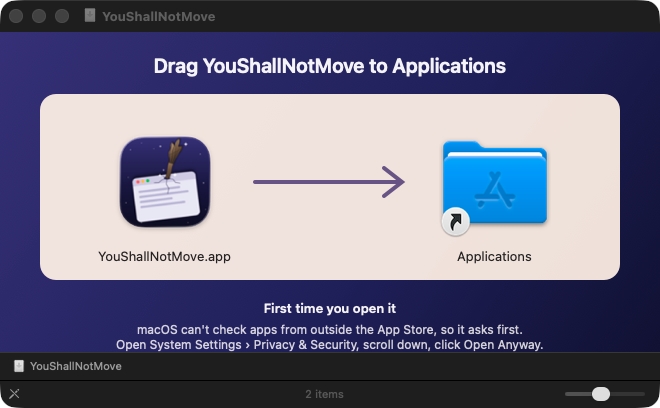
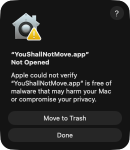
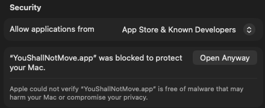

<p align="center">
  
</p>

# YouShallNotMove

[](https://buymeacoffee.com/stephanepoulin)

[](https://github.com/spoulin/youshallnotmove/releases/latest/download/YouShallNotMove.dmg)

For macOS 13 or later, on Apple silicon and Intel Macs. See [Install](#install).

A macOS menu bar app that keeps your windows where you put them.

A click on a title bar with a shaky hand moves the window by one or two pixels.
YouShallNotMove blocks window drags unless you hold a modifier key (⌘ by default).

## How it works

- An event tap watches left mouse clicks and drags.
- Click on a native title bar or an empty toolbar area: the mouse-down is held back.
  - Released within 4 px: the click is replayed, so the window still activates.
  - Dragged further: the drag is cancelled.
- Elsewhere (window background drags, custom title bars like Chrome's tab strip):
  - As soon as the window moves, a mouse-up ends the window server drag.
  - The window goes back to its original frame.
  - A one-pixel glitch can remain.
- Hold the modifier key when you click to move the window normally.
- Resizing from an edge, double-clicking a title bar and the green button are not blocked.

## Install

1. Click **Download** above to get `YouShallNotMove.dmg`, then open it.
2. Drag YouShallNotMove onto Applications.

   

3. Open YouShallNotMove from Applications. The first time, macOS says it can't check it, because
   it doesn't come from the App Store or from a developer known to Apple. Click **Done**, not
   Move to Trash.

   

4. Open **System Settings › Privacy & Security**, scroll down to **Security**, and click
   **Open Anyway** next to the message about YouShallNotMove. Confirm with your password or
   Touch ID, then click **Open Anyway** once more.

   

5. YouShallNotMove asks for Accessibility access, which it needs to see and stop window drags:
   allow it in **System Settings › Privacy & Security › Accessibility**.

Steps 3 and 4 are needed once only. Clicked Move to Trash by mistake? Open the disk image again,
drag the app onto Applications, and start over at step 3.

To update, choose **Check for Updates…** in the menu bar menu: it opens the page of the latest
version. Download it and drag it onto Applications again, replacing the old one. Every release is
signed with the same certificate, so the Accessibility access stays.

## Build and install

Requires the Xcode command line tools.

```bash
./build.sh
```

The script builds `YouShallNotMove.app`, signs it, installs it in `~/Applications` and launches it.

- It signs with `SIGN_ID` when set, else your first "Apple Development" identity, else ad hoc.
- A stable identity keeps the Accessibility permission across rebuilds.

On first launch, allow YouShallNotMove in System Settings › Privacy & Security › Accessibility.

### Releases

A version tag publishes a release: the Release workflow (`.github/workflows/release.yml`) builds
YouShallNotMove for Apple silicon and Intel, signs it, makes `YouShallNotMove.dmg` and attaches
it to a GitHub release, which the Download link above always points to.

```bash
git tag v1.0.0
git push origin v1.0.0
```

- Releases are signed with a self-signed certificate, "YouShallNotMove Release Signing", kept in
  the repository secrets `SIGNING_P12` and `SIGNING_P12_PASSWORD`. It isn't tied to an Apple
  account, so macOS asks to Open Anyway the first time; but it stays the same from one version
  to the next, so macOS keeps the Accessibility access after an update.
- To make the disk image on your Mac: `pip3 install dmgbuild`, then
  `UNIVERSAL=1 NO_INSTALL=1 ./build.sh` and
  `NAME=YouShallNotMove tools/make-dmg.sh build/YouShallNotMove.app YouShallNotMove.dmg`.

## Menu

- **You shall not move!**: turn the lock on or off.
- **Toggle shortcut**: a shortcut that turns the lock on or off from any app, ⌃⌥⌘L by default.
  - **Change…** opens a small window: press the new shortcut, or Esc to cancel.
  - It needs ⌘, ⌥ or ⌃ with a key, or a function key alone.
  - A short sound tells whether the lock is now on (Tink) or off (Pop).
- **Block during the drag**: block as described above, or only snap the window back on release.
- **Move key**: ⌘, ⌥, ⌃ or ⇧.
- **Except apps**: the open apps; the windows of a checked app move freely, without the move key.
- **Refusal sound**: the sound played when a move is refused, and its volume. Choosing one plays it.
- **Open at login**: launch at login.

The menu is in English, or in French when macOS is in French.
The French texts are in `Resources/fr.lproj/Localizable.strings`.

## Sounds

- `Sounds/make-sounds.py` synthesizes the sci-fi beeps as WAV files, which `build.sh` copies into the app.
- Change `PITCH` in it to make them deeper or higher.
- The other choices are macOS system sounds.

## Icon

- `Icon/make-icon.swift` draws the icon with Core Graphics: a gnarled staff nailing a window by its title bar.
- It also draws two earlier designs: `swift Icon/make-icon.swift out.png staff` or `seal`.
- `Icon/make-icns.sh` turns it into `Icon/AppIcon.icns`, which `build.sh` copies into the app.
- `Icon/AppIcon.png` is a 512 px copy for this README.

## Debugging

- Log: `~/Library/Logs/YouShallNotMove.log`.
- `YouShallNotMove --probe <file>` writes the Accessibility roles found at the top of each visible window.
  Run it through `open -n -a YouShallNotMove --args --probe <file>` so it gets the app's permission.

## Support

If YouShallNotMove saves your windows (and your nerves), you can buy me a coffee.

<a href="https://buymeacoffee.com/stephanepoulin"></a>

Made by [Stéphane Poulin](https://www.stephanepoulin.com).
